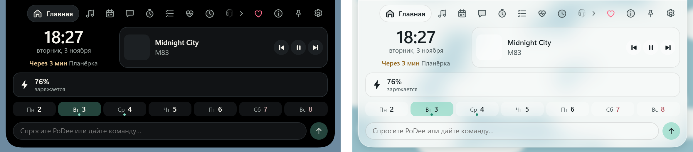
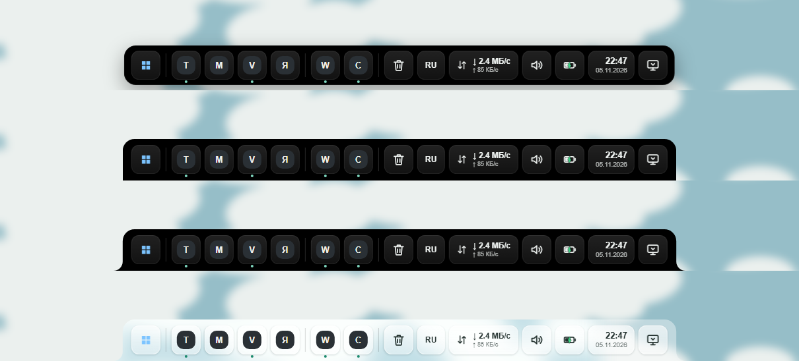
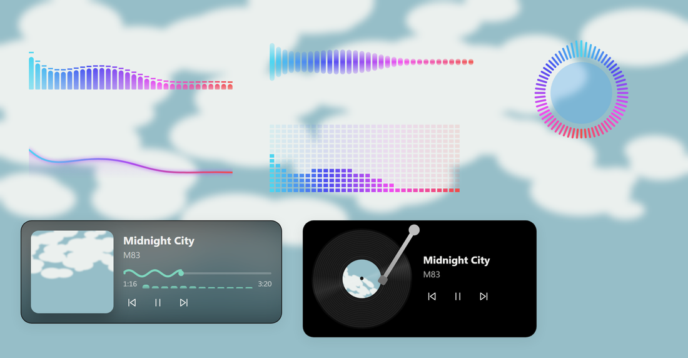
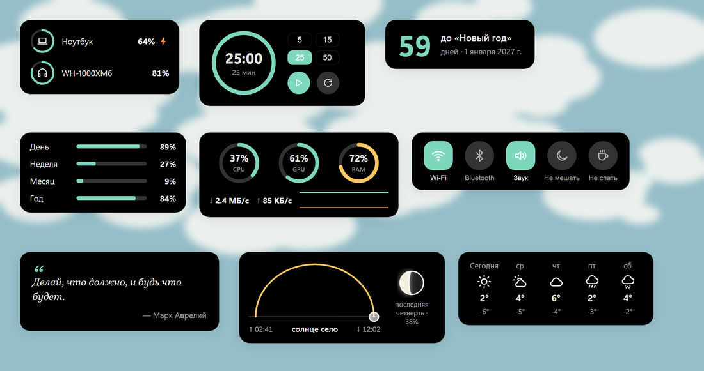
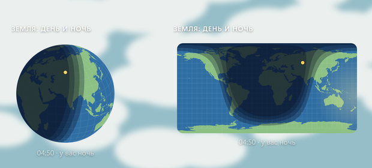
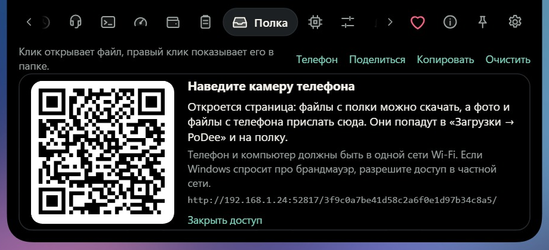
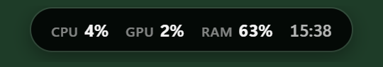

# PoDee

Остров вверху экрана Windows: часы, музыка, ИИ-чат и голос, календарь, здоровье, своя
панель задач, больше шестидесяти виджетов рабочего стола, полоска для игр и файлы на телефон
по QR-коду без приложений. Рядом живёт
PoDy, маленькое облачко.

**[Скачать установщик](https://github.com/podylab/PoDee-releases/releases/latest)**: Windows 10/11.
Всё о PoDee: [podylab.github.io](https://podylab.github.io). [Ролик на полминуты](media/podee-promo.mp4).

Здесь лежат только выпуски PoDee. Скачайте `PoDee_X.Y.Z_x64-setup.exe` (или `_x86-setup.exe`
для 32-битной Windows) из последнего выпуска и запустите. Дальше PoDee обновляется сам: когда
выйдет новая версия, остров скажет об этом, а кнопка «Обновить» в «Настройках → О программе»
поставит её.

Каждое обновление подписано ключом автора. PoDee проверяет подпись и не поставит файл,
если она не сходится.
