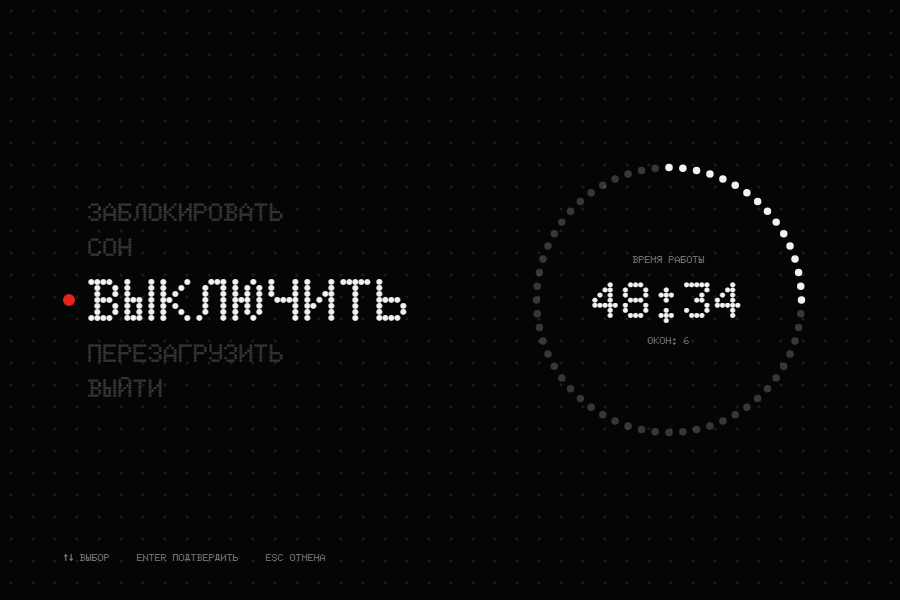
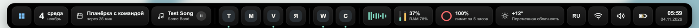
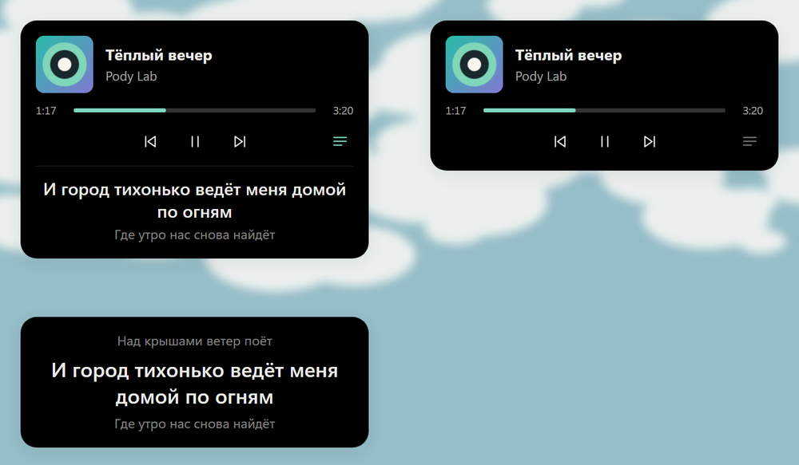

# PoDee

Остров вверху экрана Windows: часы, музыка, ИИ-чат и голос, календарь, здоровье, своя
панель задач, больше шестидесяти виджетов рабочего стола на любом мониторе, полоска для игр и файлы на телефон
по QR-коду без приложений. Рядом живёт
PoDy, маленькое облачко.

**[Скачать установщик](https://github.com/podylab/PoDee-releases/releases/latest)**: Windows 10/11.
Собирается под вас: каждая часть — модуль, а виджеты и блоки панели задач ставятся куда угодно.
Всё о PoDee: [podylab.github.io](https://podylab.github.io). [Ролик на полминуты](media/podee-promo.mp4).

Здесь лежат только выпуски PoDee. Скачайте `PoDee_X.Y.Z_x64-setup.exe` (или `_x86-setup.exe`
для 32-битной Windows) из последнего выпуска и запустите. Дальше PoDee обновляется сам: когда
выйдет новая версия, остров скажет об этом, а кнопка «Обновить» в «Настройках → О программе»
поставит её.

В 1.9.2: в AnalogOS всё из стекла, матовое или жидкое на выбор, сквозь него видны окна программ;
новый экран выключения, обои «Дюны» и «Веер»; уведомления закрываются смахиванием; распознавание
речи знает имена; обои версии из Microsoft Store больше не чёрные.

В 1.9.0: тема AnalogOS — полоса меню во всю ширину, у каждого раздела своё окно, панель задач
из жидкого стекла, светлая и тёмная; ассистент пишет в мессенджеры («напиши Пете в телеге…»);
файл, перетащенный на значок панели задач, поднимает окно программы.

В 1.8.2: виджет «Плеер с текстом песни» (текст прячется одной кнопкой); панель задач слева и справа
в нормальном размере; текст везде помещается.

В 1.8.0: тема «Орбита» — остров, панель задач, виджеты, Настройки и экран выключения из точек;
галерея обоев; панель задач поверх окон оставляет полосу экрана за собой.

Каждое обновление подписано ключом автора. PoDee проверяет подпись и не поставит файл,
если она не сходится.
