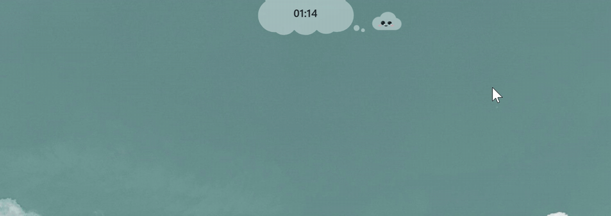

# PoDee

Остров вверху экрана Windows: часы, музыка, ИИ-чат и голос, календарь, здоровье,
виджеты рабочего стола и док. Рядом живёт PoDy, маленькое облачко.

**[Скачать установщик](https://github.com/podylab/PoDee-releases/releases/latest)**: Windows 10/11.

Здесь лежат только выпуски PoDee. Скачайте `PoDee_X.Y.Z_x64-setup.exe` из последнего выпуска
и запустите. Дальше PoDee обновляется сам: когда выйдет новая версия, остров скажет об этом,
а кнопка «Обновить» в «Настройках → О программе» поставит её.

Каждое обновление подписано ключом автора. PoDee проверяет подпись и не поставит файл,
если она не сходится.
